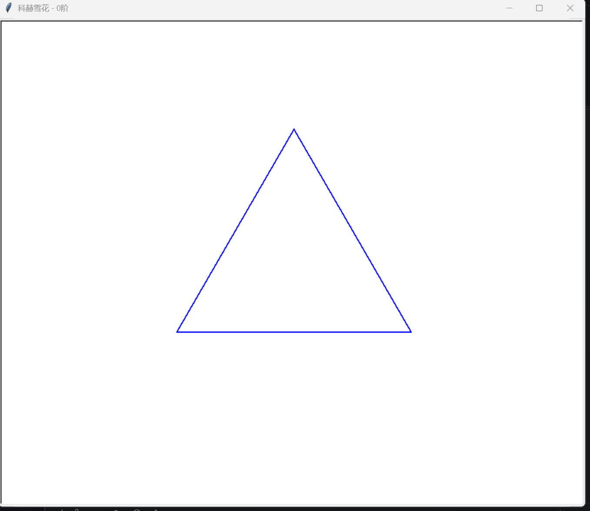
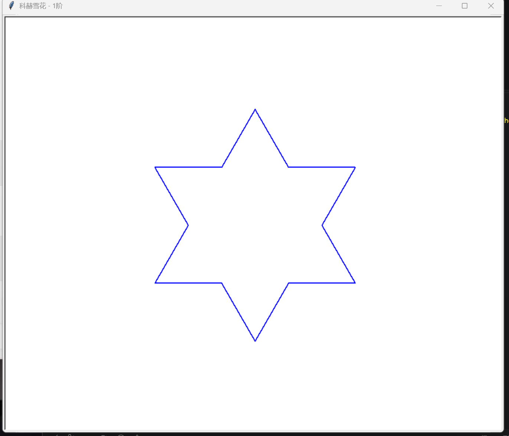
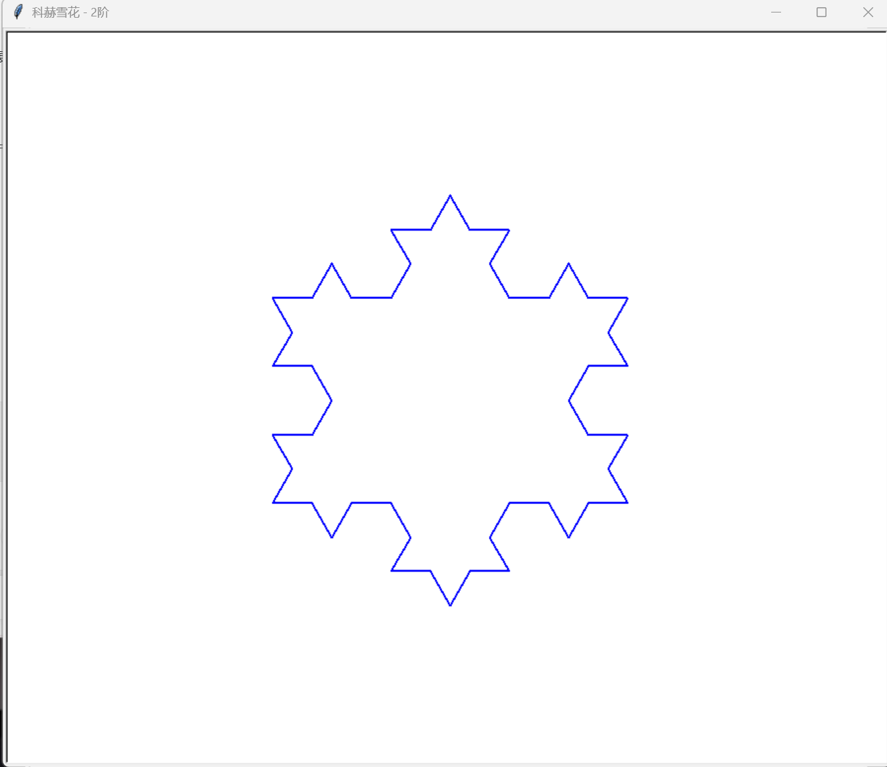
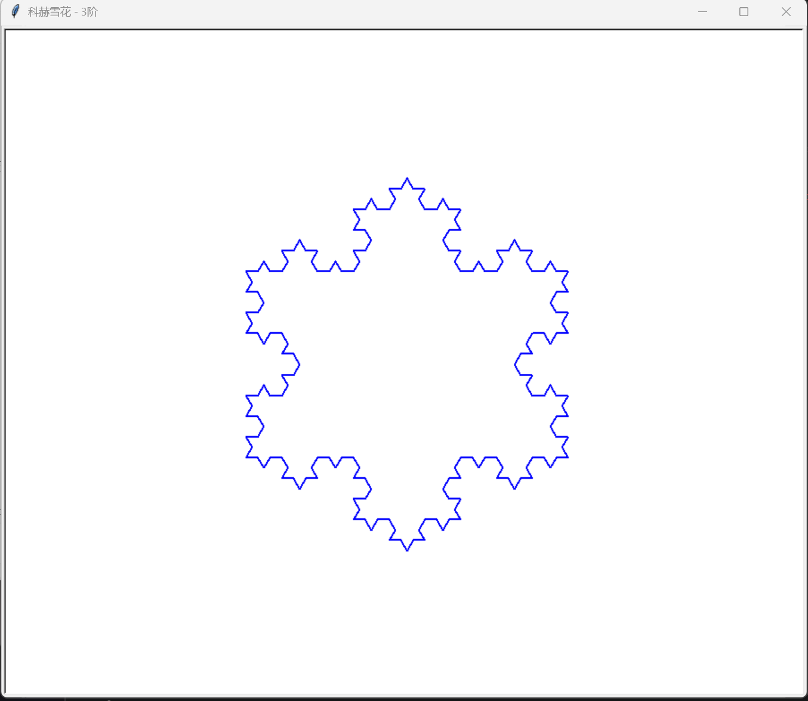
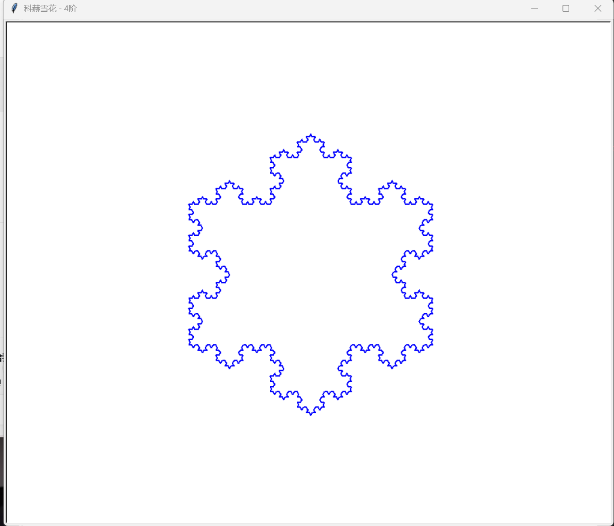

# Python 科赫雪花递归绘制作业

## 一、项目简介

本项目是 Python 课程的科赫雪花绘制实验，使用 Python 的 turtle 绘图库和递归函数，实现根据输入阶数绘制不同复杂程度的科赫雪花。

根据老师要求，程序支持生成 0～4 阶科赫雪花，并通过实际运行验证不同阶数的绘图效果。

## 二、实验目的

1. 理解递归函数的基本原理。
2. 掌握 Python 函数的定义与调用。
3. 学习使用 turtle 绘图库绘制图形。
4. 理解科赫雪花的分形生成过程。
5. 通过不同阶数的测试，观察递归层数对图形的影响。

## 三、实验原理

科赫雪花是一种经典的分形图形，从一个等边三角形开始，通过不断细分线段形成复杂的雪花边界。

程序采用递归方法绘制科赫曲线。

当阶数为 0 时，直接绘制一条直线。

当阶数大于 0 时，将一条线段分成三等份，并通过转向操作，将原来的线段替换成四条长度为原来三分之一的线段。

每次递归都重复这一过程。

程序中的主要递归操作包括：

```python
koch_curve(pen, length, order - 1)
pen.right(60)
koch_curve(pen, length, order - 1)
pen.left(120)
koch_curve(pen, length, order - 1)
pen.right(60)
koch_curve(pen, length, order - 1)
```

最后通过绘制三条科赫曲线，组成完整的雪花图形。

## 四、开发环境

- 操作系统：Windows
- 编程语言：Python 3.14.2
- 开发工具：Visual Studio Code
- 绘图库：turtle
- 版本管理工具：Git、GitHub

本程序使用 Python 标准库，不需要额外安装第三方绘图库。

运行绘图程序需要支持图形窗口的 Python 环境。

## 五、项目文件说明

- `main.py`：科赫雪花递归绘制程序。
- `README.md`：项目说明文档。
- `docs/screenshots/`：保存 0～4 阶科赫雪花运行截图。
- `docs/experiment_summary.md`：实验过程与总结文档（后续补充）。

## 六、程序运行方法

在项目目录中打开 VS Code 终端，执行：

```bash
python main.py
```

程序将提示输入：

```text
请输入科赫雪花阶数（0～4）：
```

输入 0、1、2、3 或 4，程序即可绘制对应阶数的科赫雪花。

如果输入不在规定范围内，程序会显示错误提示。

## 七、实验结果

本次实验分别测试了 0～4 阶科赫雪花，五组测试均成功绘制对应图形。

| 阶数 | 线段数量 | 绘图结果 |
|---|---:|---|
| 0 阶 | 3 | 等边三角形，测试通过 |
| 1 阶 | 12 | 六角星状雪花，测试通过 |
| 2 阶 | 48 | 出现更多三角形凸起，测试通过 |
| 3 阶 | 192 | 雪花边缘更加复杂，测试通过 |
| 4 阶 | 768 | 形成更加精细的分形图案，测试通过 |

### 1. 0 阶科赫雪花



### 2. 1 阶科赫雪花



### 3. 2 阶科赫雪花



### 4. 3 阶科赫雪花



### 5. 4 阶科赫雪花



## 八、实验分析

通过对比不同阶数的科赫雪花，可以发现：

0 阶雪花是一个普通的等边三角形，图形结构简单。

1 阶开始出现向外凸起的小三角形，形成六角星状的轮廓。

2 阶和 3 阶不断增加新的细节，使雪花边缘更加复杂。

4 阶的分形特征更加明显，边界包含大量细小的线段。

随着递归阶数增加，线段数量按照以下规律增长：

\[
N=3\times4^n
\]

其中 n 表示科赫雪花的阶数。

这说明递归能够通过重复执行相同的绘制规则，生成复杂的图形。

## 九、实验收获

通过本次实验，我进一步理解了 Python 递归函数的使用方法，认识到递归就是在函数内部不断调用自身，并通过设置结束条件停止递归。

在绘制科赫雪花的过程中，我学习了使用 turtle 控制画笔前进、转向以及设置绘图窗口等操作。

通过依次绘制 0～4 阶科赫雪花，我直观地观察到了递归阶数变化对图形复杂程度的影响，也认识到看起来复杂的分形图案，可以通过简单的规则不断重复生成。

此外，我还练习了使用 VS Code 编写和运行程序，以及通过 GitHub 保存代码和实验结果。

## 十、实验总结

本次实验使用 Python 的 turtle 绘图库和递归函数，实现了 0～4 阶科赫雪花的绘制，并通过五组测试验证了程序的正确性。

通过实验，我巩固了 Python 函数、递归和循环等基础知识，加深了对递归绘图与分形图形的理解。